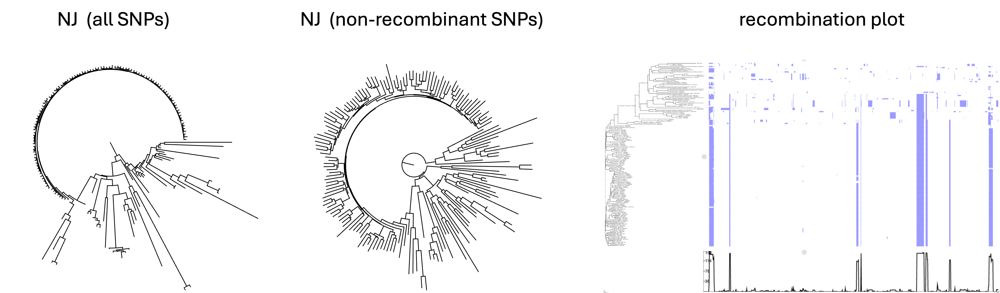
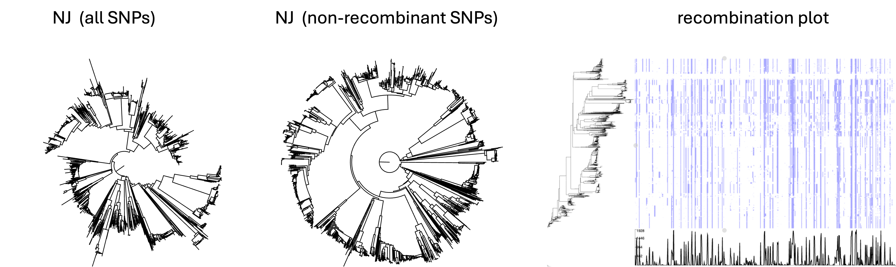

[](https://github.com/rderelle/noref/actions/workflows/ci.yml)
[](https://github.com/rderelle/noref/actions/workflows/clippy.yml)
[](https://codecov.io/github/rderelle/noref)
[](https://bioconda.github.io/recipes/noref/README.html)

<p align="center">
  
</p>


noref ('no reference' genome needed) is designed for within-species phylogenetic analyses (population genomics) from genome assemblies, in a fast and easy way. It is only recommended for bacterial species and only accepts genome assemblies as input (not sequencing reads).

In most bacterial phylogenomic workflows, SNP calling and recombination detection are separate steps. SNPs are often mapped onto a reference genome, and recombination tracts are then identified and removed using tools such as [ClonalFrameML](https://github.com/xavierdidelot/ClonalFrameML), [Gubbins](https://github.com/nickjcroucher/gubbins) or [Verticall](https://github.com/rrwick/Verticall).
noref was developed to perform both steps, SNP calling and detection of recombination tracts, in a reference-free manner.
This reduces biases and greatly simplifies phylogenetic workflows: there is no need to choose a suitable reference, and both steps are handled by a single tool.

> [!NOTE]
> Please note that this tool is still under development.

## under the hood
- SNP calling: this is essentially the algorithm developed in [kamino](https://github.com/rderelle/kamino), but using nucleotides instead of amino acids. Also, the genomic positions in the original input assemblies of each extracted sequence from each variant group are saved in memory instead of protein names, allowing the next step to happen.
- detection of recombination: SNPs are first clustered by isolate profile. Then each input assembly is scanned for local enrichment of each SNP cluster independently, using a window scan and a binomial test (p-value threshold with Bonferroni correction): SNPs in significant windows are masked in the corresponding isolate.

## installation
```bash
conda install bioconda::noref
```
or from source:

```bash
git clone https://github.com/rderelle/noref.git
cd noref
cargo build --release           # binary: target/release/noref
```

## usage
```bash
# standard analysis of genome assemblies using 4 CPUs
noref -i <input_dir> -t 4

# also get NJ trees (of the raw and filtered SNP alignments)
noref -i <input_dir> -t 4 --nj

# also get a recombination gff file for Phandango, on the genome of isolate '670-6B'
noref -i <input_dir> -t 4 --plot 670-6B
```
## examples
Genome assemblies were obtained from the AllTheBacteria project. noref was run with default parameters, and the resulting phylogenetic trees were midpoint-rooted. Runtimes (seconds) and RAM usage (GB) were measured on a MacBook Pro M4.

#### 171 S. pneumoniae genomes (3s/0.7GB)
This dataset corresponds to the PMEN2 group analysed by [Croucher et al 2014](https://link.springer.com/article/10.1186/1741-7007-12-49). The inferred recombination pattern closely resembles that reported in the original study, including recombination hotspots associated with transposons. Gubbins analyses of the same dataset are also available in the Supplementary Material of [this paper](https://academic.oup.com/mbe/article/42/4/msaf077/8103706)).



#### 1932 N. gonnorahea genomes (38s/4.3GB)
This dataset corresponds to the Euro-GASP 2020 study published by [Golparian et al 2024](https://www.thelancet.com/journals/lanmic/article/PIIS2666-5247(23)00370-1/fulltext). Although I haven't checked the locations of recombination hotspots, the overall recombination pattern is consistent with published Gubbins analyses of N. gonnorahea genomes (see examples [here](https://jameshadfield.github.io/phandango/#/examples) and [here](https://pmc.ncbi.nlm.nih.gov/articles/PMC6998845/))



## input
Bacterial genome assemblies in a directory with `-i`, or paths of input files provided in a headerless tab-delimited file using the `-I` argument (see [here](https://github.com/rderelle/kamino#input) for more details).

## output
SNP alignments (with some constant positions; not a pseudo-alignment of genomes), midpoint rooted NJ trees with `--nj`, and a recombination gff file for [Phandango](https://github.com/jameshadfield/phandango) with `-p`/`--plot`.
For the latter, the name of the input isolate whose genome the recombinant SNPs will be mapped onto should be indicated.

> [!TIP]
> IMHO, whether to include recombinant SNPs in phylogenetic analyses depends on the question being asked:
> - *How different or similar are the isolates to each other?* -> all SNPs
> - *How related are the isolates to each other* -> non-recombinant SNPs (filtered SNPs)

---
This codebase is provided under the MIT License. The code was drafted using AI assistance.
